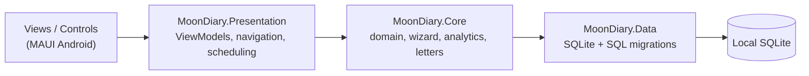

# MoonDiary

A personal mood diary for Android: you log the day in the evening, when it is over, and the app turns those entries into a calendar, weekly insights, and advice.

> The UI strings in the app are Russian.

<!-- Screenshot: add a calendar or evening-wizard screenshot here, e.g.  -->

## Features

- **Evening entry wizard** — one evening entry per day, with two 1–5 mood scales (energy and positivity) and optional cards for what got done, an achievement, and how the day felt.
- **Daytime check-ins** — quick mood notes during the day (the same two scales plus short text); several check-ins per day are allowed.
- **Drafts** — an unfinished evening entry can be saved as a draft (at most one draft per day) and continued later.
- **Tag blocks** — short, tappable prompt phrases with an icon and a life-direction (sleep, work, health, relationships, household, emotions). Starter tags ship with the app; custom tags can be created, archived, and suggested based on usage.
- **Calendar dashboard** — the home screen shows a month of days colored by mood, with a day detail view.
- **Weekly analytics and reports** — local rules produce a week summary, pattern findings, achievements, week-to-week comparison, a mood dynamics chart, and advice the user can mark useful or not relevant. Reports can be listed and opened later.
- **Letters** — write a note to your future self, choose an open date (from the next day onward), and get a local notification at 10:00 when a letter is due.
- **Reminders** — optional local evening reminder (default 18:00) with an adaptive-reminder setting.
- **Settings** — light, dark, or auto theme; reminder preferences; JSON export and import of local data (import first writes a backup); Android auto-backup status when the platform supports it.
- **Onboarding and first-run routing** — first launch goes through onboarding; later launches open the calendar, the evening wizard, a weekly report, or a due letter, depending on time and state. A dedicated screen is shown if the database cannot be opened.
- **Offline and on-device** — data lives in a local SQLite database. There is no account, cloud sync, or server-side AI.
- **Test hooks (debug builds only)** — intent extras can override the clock, database file, seed data, and the first screen so UI tests can run deterministically. Release builds ignore these extras.

## Tech stack

- **.NET 10** and **.NET MAUI** (Android only; `net10.0-android`, min SDK 21)
- **CommunityToolkit.Mvvm** for ViewModels and commands
- **Microsoft.Data.Sqlite** with handwritten SQL migrations
- **xUnit** unit tests; **Appium** + UiAutomator2 UI tests (`Appium.WebDriver`)
- Central package versions via `Directory.Packages.props`
- GitHub Actions workflow for unit tests (`.github/workflows/unit-tests.yml`)

## Architecture

The MAUI app project hosts Android pages and controls. Domain rules, data access, and ViewModels live in separate class libraries so unit tests can run without the Android SDK.



- `MoonDiary.Core` — domain model, evening wizard, check-ins, tags, calendar calculations, analytics rule engine (JSON rule catalog), weekly reports, letters, reminders, and JSON export/import.
- `MoonDiary.Data` — SQLite connection, migration runner, and repositories.
- `MoonDiary.Presentation` — ViewModels, route names, theme/file/notification abstractions, startup coordinator, and debug launch-option parsing.
- `MoonDiary.csproj` — the Android application: `AppShell`, pages under `Views/`, custom controls, and platform services under `Platforms/Android`.
- `tests/MoonDiary.Tests` — unit tests against the libraries above (31 test files).
- `tests/MoonDiary.UiTests` — black-box Appium scenarios against a debug APK.

Product behavior is specified in `docs/requirements/`. Coding conventions and layering are in `docs/dev/conventions.md`.

## How to run

Prerequisites: **.NET 10** with the **MAUI** workload, an **Android SDK**, and a **JDK**.

### Unit tests

No Android SDK is required for this project:

```bash
dotnet test tests/MoonDiary.Tests
```

CI on `ubuntu-latest` runs the same command on every push and pull request to `main` and `dev`, and uploads a TRX report.

### Build an APK

```bash
dotnet build MoonDiary.csproj -f net10.0-android
```

If the SDK or JDK is not in a default location, pass the paths:

```bash
dotnet build MoonDiary.csproj -f net10.0-android \
  -p:AndroidSdkDirectory="$ANDROID_HOME" \
  -p:JavaSdkDirectory="$JAVA_HOME"
```

A signed debug APK is written to `bin/Debug/net10.0-android/com.moondiary.app-Signed.apk`.

You can also use the repo script (paths default to `~/Library/Android/sdk` and `~/Library/Java/microsoft-jdk`, or to `ANDROID_HOME` / `JAVA_HOME`):

```bash
scripts/build-apk.sh debug
scripts/build-apk.sh release
```

The script copies the APK to `artifacts/moondiary-<version>-<mode>.apk`. A release build without `MOONDIARY_KEYSTORE`, `MOONDIARY_KEY_ALIAS`, and `MOONDIARY_KEYSTORE_PASS` is signed with the debug key (fine for a personal device, not for store publishing).

To install SDK components and accept licenses, use the `InstallAndroidDependencies` target with `-p:AcceptAndroidSdkLicenses=True`.

### UI tests (Appium)

These are not run in CI. You need a running Android emulator, Node.js, Appium, and the UiAutomator2 driver:

```bash
npm install -g appium
appium driver install uiautomator2
dotnet build MoonDiary.csproj -f net10.0-android -c Debug -p:EmbedAssembliesIntoApk=true
appium
```

In another terminal:

```bash
export MOONDIARY_APK_PATH="$PWD/bin/Debug/net10.0-android/com.moondiary.app-Signed.apk"
export MOONDIARY_TEST_RESULTS_DIR="$PWD/TestResults/Appium"
dotnet test tests/MoonDiary.UiTests/MoonDiary.UiTests.csproj \
  --logger "trx;LogFileName=appium.trx" \
  --results-directory "$MOONDIARY_TEST_RESULTS_DIR"
```

Optional: `MOONDIARY_APPIUM_URL` (default `http://127.0.0.1:4723`) and `MOONDIARY_DEVICE_NAME` (default `Android`). Each scenario starts the app fresh with its own `ui-<id>.db`. Failed scenarios save a PNG under the results directory.

### Debug launch extras

Debug builds read intent extras (`moondiary_now`, `moondiary_db`, `moondiary_seed`, `moondiary_open`). Example:

```bash
adb shell am start -n com.moondiary.app/com.moondiary.app.MainActivity \
  --es moondiary_now "2026-11-10T19:30:00+03:00" \
  --es moondiary_db demo.db \
  --es moondiary_seed month
```

Seed values present in the testing code include `empty`, `month`, and `report`. `moondiary_open` can be `wizard` or `letter:<id>`.

## Project structure

```
MoonDiary.csproj              # Android MAUI app
AppShell.xaml                 # Shell routes: loading, onboarding, databaseError, calendar, analytics, letters, user
Views/                        # Pages (wizard, check-in, calendar, reports, letters, settings, …)
Controls/                     # Bottom bar, calendar, mood scale, charts, …
Platforms/Android/            # Android entry point and platform services
src/MoonDiary.Core/           # Domain and application services
src/MoonDiary.Data/           # SQLite and migrations
src/MoonDiary.Presentation/   # ViewModels and navigation
tests/MoonDiary.Tests/        # Unit tests
tests/MoonDiary.UiTests/      # Appium UI tests
scripts/build-apk.sh
docs/dev/conventions.md
docs/requirements/            # Product requirements (Russian)
```
